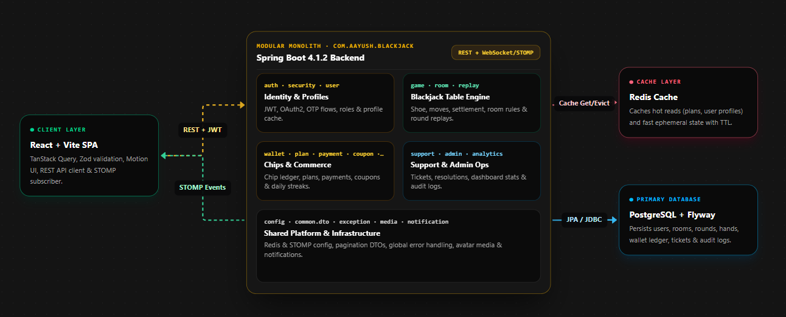

<div align="center">

# 🃏 Blackjack <span style="color:#F59E0B">Royale</span> — Single-Player Blackjack & Admin Control Platform

<a href="https://blackjack-bice-omega.vercel.app">
  
</a>

[](https://blackjack-bice-omega.vercel.app)
[](https://blackjack-bice-omega.vercel.app/architecture)
[](https://blackjack-royale.duckdns.org/swagger-ui/index.html)
[](https://opensource.org/licenses/MIT)

<br />

<a href="https://blackjack-bice-omega.vercel.app/architecture" target="_blank">
  
</a>

<br />
<i>Single-player Blackjack tables, STOMP WebSocket state sync, Redis caching, and HTTPS-secured payments & auth.<br/><b>Click the architecture diagram above to explore the interactive system topology!</b></i>
<br /><br />

</div>

---

## 💻 Tech Stack

<div align="center">
  
  
  
  
  
  
  
  
  
</div>

---

## 🏗️ System Architecture

Blackjack Royale splits single-player table state synchronization, transactional persistence, caching, and role-based control flows across a React client and a Spring Boot backend deployed behind Nginx TLS termination:

| Layer / Component | Stack & Role | Responsibility |
| :--- | :--- | :--- |
| **Frontend Client** | React + Vite + TypeScript + Tailwind CSS | Single-player room selection, live table UI, JWT/refresh token session handling, one-click demo access, admin console, and interactive `/architecture` view. |
| **Backend API & Game Engine** | Spring Boot 4.1.2 + Java + Spring Security | Authentication (email/OTP, Google OAuth2, JWT + `refresh_token` cookie), single-player Blackjack rules & hand flow, wallet/chip operations, payment webhook handling, and admin endpoints. |
| **Real-Time Messaging** | WebSocket + STOMP | Streams live single-player table updates, dealer/player actions (`hit`, `stand`, `double`, betting rounds), and room events smoothly. |
| **Relational Data Store** | PostgreSQL | Stores users, roles (`USER` / `ADMIN`), wallets/transactions, rooms, and persistent application state. |
| **Cache Layer** | Redis Cache | Accelerates hot read paths, session/state caching, and transient lookups to keep gameplay responsive. |
| **Reverse Proxy & TLS** | Oracle Linux VM + Nginx + Let's Encrypt (Certbot) | Terminates HTTPS on `blackjack-royale.duckdns.org`, upgrades WebSocket connections, and forwards `X-Forwarded-Proto` / `X-Forwarded-Host` headers. |


---

## ✨ Core Features

Click to expand and explore Blackjack Royale's capabilities:

<details>
<summary><b>🃏 Single-Player Blackjack Tables via WebSocket & STOMP</b></summary>
Enter single-player rooms, place bets, and play synchronized rounds against the dealer with live table state updates pushed over WebSocket + STOMP topics and queues.
</details>

<details>
<summary><b>⚡ Redis Caching & PostgreSQL Persistence</b></summary>
Combines <b>PostgreSQL</b> for durable relational data (accounts, balances, game/transaction records) with <b>Redis Cache</b> to reduce repeated read latency during active play.
</details>

<details>
<summary><b>🔐 JWT, Refresh Cookies, Google OAuth2 & One-Click Demo Access</b></summary>
Supports standard credential login, email OTP verification, Google OAuth2 sign-in with proxy-aware forwarded headers, cross-site <code>SameSite=None; Secure</code> refresh cookies, and instant portfolio demo buttons for both User and Admin views.
</details>

<details>
<summary><b>🛡️ Role-Based Access Control & Admin Panel</b></summary>
Separates single-player routes (<code>/rooms</code>) from protected administrative views (<code>/admin</code>) using role guards on both the frontend and Spring Security backend.
</details>

<details>
<summary><b>🌐 Production HTTPS Reverse Proxy & Interactive Topology</b></summary>
Deployed with Nginx + Certbot auto-renewal on Oracle Cloud Infrastructure alongside an interactive system architecture page at <code>/architecture</code>.
</details>

---

## 🚀 Getting Started

Follow these steps to run Blackjack Royale locally or connect the frontend to your deployed backend.

### Prerequisites
- **Java 21+** (or Java 25) & Maven (`./mvnw`)
- **Node.js 18+** & npm
- **PostgreSQL** & **Redis** (local instances or managed cloud providers such as Neon and Upstash)

---

### 1. Clone the Repository
```bash
git clone https://github.com/Aayush6377/blackjack
cd blackjack
```

### 2. Configure Environment Variables (`.env`)

Each folder has its own `.env.example` template—copy `.env.example` to `.env` inside both `backend/` and `frontend/`, then fill in your local or deployment values:

```bash
cp backend/.env.example backend/.env
cp frontend/.env.example frontend/.env
```

### 3. Run the Services

#### Option A: Run Locally (Backend + Frontend)
Open two terminals and start each layer:

```bash
# Terminal 1 — Spring Boot 4.1.2 Backend (Port 8080)
cd backend
set -a && source .env && set +a
./mvnw spring-boot:run
```

```bash
# Terminal 2 — React + Vite Frontend (Port 5173)
cd frontend
npm install
npm run dev
```

#### Option B: Package JAR & Serve via Nginx on Linux VM
Build the Spring Boot JAR and run it behind Nginx with HTTPS enabled via Certbot:

```bash
cd backend
./mvnw clean package -DskipTests
set -a && source .env && set +a
nohup java -XX:MaxRAMPercentage=50.0 -jar target/*.jar > app.log 2>&1 &
```

---

## 👨‍💻 Connect with the Developer

**Aayush Kukreja** *Full Stack & Distributed Systems Developer.*

[](https://aayush-kukreja-portfolio.vercel.app)
[](https://www.linkedin.com/in/aayush-kukreja-b5885324a)
[](https://github.com/Aayush6377)

<div align="center">
  <br />
  <i>If you found this project interesting, please consider giving it a ⭐!</i>
</div>